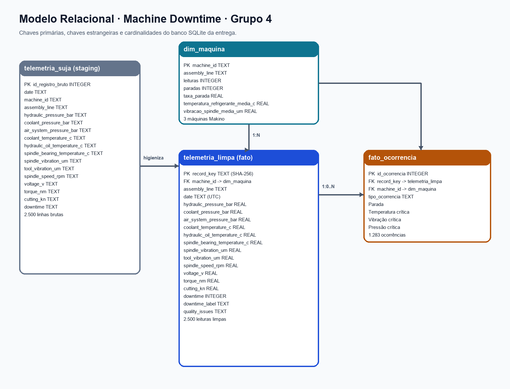

# 🏭 GRUPO 4 — ENTREGA FINAL | MANUFATURA E EFICIÊNCIA (OEE)

**Smart Talent John Deere · Remoto 01 · Aula 1**  
**Prazo original informado:** 30/10/2026 às 23h59.

> **Comece aqui:** esta pasta reúne os artefatos das Partes 1 e 2 e orientações para a Parte 3. Os arquivos técnicos estão preparados; os requisitos individuais e o board do Sábado 2 ainda precisam ser confirmados. **Uma entrega por grupo.**

## 🎯 Entrega em 30 segundos

**O que enviar:** [5 consultas SQL com perguntas e interpretações](sql/02_cinco_consultas_SQLite.sql) + [modelo relacional em PNG](docs/modelo_relacional.png) (ou [PDF](docs/modelo_relacional.pdf)). **Uma entrega por grupo.**

**O que preparar para o Sábado 2:** GitHub com 2FA, Docker funcionando, dois EADs e board com responsáveis. Confira o [checklist de preparação](docs/preparacao_sabado2.md).

**Para o portal:** [texto consolidado da entrega](docs/TEXTO_DE_ENTREGA.md) · [relatório executivo em PDF](docs/Relatorio_Grupo4_OEE.pdf) · [guia detalhado](docs/00_LEIA_ME_PRIMEIRO.md). Esses são complementos, não substitutos dos arquivos obrigatórios.

---

## 1. O que entregar

| Parte | O que o professor pediu | Arquivo para envio | Situação |
|---|---|---|---|
| **1 — SQL** | Cinco perguntas, cinco consultas e uma frase interpretativa por consulta | [02_cinco_consultas_SQLite.sql](sql/02_cinco_consultas_SQLite.sql) | Preparado |
| **2 — Modelo de dados** | Desenho com entidades, relações, chaves primárias e estrangeiras | [modelo_relacional.png](docs/modelo_relacional.png) ou [PDF](docs/modelo_relacional.pdf) | Preparado |
| **3 — Preparação do Sábado 2** | 2FA, Docker, EADs e board atualizado com donos | [Checklist](docs/preparacao_sabado2.md) | Pendente de confirmação |

**Entrega mínima expressa no enunciado:** enviar **um arquivo `.sql` (ou texto)** com perguntas, consultas e interpretações **mais o desenho do modelo**. A Parte 3 requer ações dos integrantes; anexar um checklist não comprova sua conclusão. [Texto de entrega](docs/TEXTO_DE_ENTREGA.md) e [relatório PDF](docs/Relatorio_Grupo4_OEE.pdf) são complementares, caso o portal permita.

## 2. Parte 1 — Cinco consultas SQL

As perguntas usam telemetria de máquinas e ocorrência de alertas como indicadores de risco operacional. **Não calculam o valor real do OEE**, pois não há todas as medições de disponibilidade, desempenho e qualidade.

| Nº | Técnica exigida | Pergunta de negócio | Interpretação dos resultados processados |
|---|---|---|---|
| 1 | `WHERE` + `ORDER BY` + `LIMIT 10` | Quais são as 10 leituras mais críticas? | A leitura **4238**, da máquina **7**, liderou a triagem com **2 alertas simultâneos**. |
| 2 | Agregação + `GROUP BY` | Qual turno concentra mais alertas e leituras incompletas? | O turno **A** teve **0,96 alerta de sensor por 100 leituras**; o turno **C** teve **7,29%** de leituras incompletas. |
| 3 | `JOIN ... ON` | Quais máquinas e faixas de uso concentram cada tipo de ocorrência? | As máquinas **5 e 21** tiveram **18 ocorrências cada**, incluindo leituras incompletas. |
| 4 | `HAVING` + subconsulta | Quais máquinas estão acima da média geral de alertas por leitura? | A máquina **5** registrou **3,35 alertas por 100 leituras**, contra **0,68** da frota. |
| 5 | Livre | Quais máquinas priorizar para inspeção e quais estão piorando? | A máquina **22** liderou o ranking com **4 pontos** e tendência de piora no período avaliado. |

O arquivo [SQL completo](sql/02_cinco_consultas_SQLite.sql) contém cada pergunta por escrito, a consulta e sua frase de interpretação. Os valores foram calculados a partir do CSV disponibilizado ao grupo; o resultado de cada consulta está em [resultados/](resultados/).

### Critérios de correção conferidos no código

- [x] Cada consulta está associada a uma pergunta explícita.
- [x] Colunas escolhidas explicitamente, sem `SELECT *` (`COUNT(*)` é uma função de contagem e é permitido).
- [x] `WHERE` e `ORDER BY` na consulta 1.
- [x] `GROUP BY` e agregações na consulta 2.
- [x] `JOIN` com `ON` na consulta 3.
- [x] `HAVING` e subconsulta na consulta 4.
- [x] Frase interpretativa por consulta, com resultados da base.

Esses itens mostram aderência estrutural ao enunciado, **não equivalem a uma nota do professor**.

### Dataset e desafio adicional

A origem é [telemetria_suja.csv](dados/telemetria_suja.csv), com **4.060 linhas**. A base [grupo4_telemetria.db](dados/grupo4_telemetria.db) contém **4.000 leituras tratadas** (após retirar **60 duplicatas idênticas**), **24 máquinas** e **298 ocorrências**. A tabela `telemetria_suja` preserva os dados brutos.

O [desafio com `SELECT DISTINCT`](sql/03_desafio_dimensao_distinct.sql) mostra como criar uma tabela temporária com cada `id_maquina` uma única vez usando `CREATE TEMP TABLE ... AS SELECT DISTINCT`, e depois relacioná-la às leituras usando `LEFT JOIN ... ON`. A dimensão permanente `dim_maquina` é definida em [01_modelo_sqlite.sql](sql/01_modelo_sqlite.sql).

## 3. Parte 2 — Modelo de dados

**Anexar:** [modelo_relacional.png](docs/modelo_relacional.png) ou [modelo_relacional.pdf](docs/modelo_relacional.pdf).

| Entidade | Chave primária (PK) | Relações essenciais |
|---|---|---|
| `dim_maquina` | `id_maquina` | Uma máquina possui muitas leituras e pode ter várias ocorrências. |
| `telemetria_limpa` | `id_leitura` | `id_maquina` é FK para `dim_maquina`. |
| `fato_ocorrencia` | `id_ocorrencia` | `id_maquina` referencia a máquina; `(id_leitura, id_maquina)` referencia a leitura. |
| `telemetria_suja` | `id_registro_bruto` | Guarda registros originais da importação. |
| `rejeicoes_importacao` | `id_rejeicao` | Guarda registros rejeitados na preparação. |

**Como ler:** uma máquina pode gerar várias leituras (1:N); uma leitura pode gerar zero ou várias ocorrências (1:0..N). Consulte o [script de criação das tabelas](sql/01_modelo_sqlite.sql) para as restrições completas.



## 4. Parte 3 — Preparação do Sábado 2

**Nenhum item abaixo deve ser marcado como concluído sem confirmação pessoal ou evidência.**

- [ ] Conta GitHub verificada e autenticação de dois fatores (2FA) habilitada.
- [ ] Docker Desktop instalado e `docker run hello-world` executado com sucesso.
- [ ] EAD de continuação de Python concluído.
- [ ] EAD de Git e GitHub concluído.
- [ ] Board atualizado com tarefas [S2] e **um responsável identificado em cada cartão**.

O [checklist detalhado](docs/preparacao_sabado2.md) explica quais cartões foram identificados no board e o que ainda precisa ser validado. O repositório **não comprova** instalação de Docker, conclusão dos EADs, 2FA ou atribuição nominal de cada tarefa.

## 5. Como executar e verificar

No **DB Browser for SQLite**:

1. Abrir **Banco de Dados** e selecionar [`dados/grupo4_telemetria.db`](dados/grupo4_telemetria.db).
2. Ir a **Executar SQL**, abrir [`sql/02_cinco_consultas_SQLite.sql`](sql/02_cinco_consultas_SQLite.sql) e **executar uma consulta por vez**.
3. Comparar as saídas com os cinco arquivos `resultado_consulta_1.csv` a `resultado_consulta_5.csv` na pasta [resultados/](resultados/).
4. Para o desafio, executar [`sql/03_desafio_dimensao_distinct.sql`](sql/03_desafio_dimensao_distinct.sql).

Também é possível recriar o banco e rodar as consultas com Python 3, sem bibliotecas de terceiros. A partir da pasta `docs/entrega-aula-1`:

```bash
python scripts/preparar_banco.py dados/telemetria_suja.csv novo_banco.db
python scripts/executar_consultas.py dados/grupo4_telemetria.db novas_saidas
```

O primeiro comando cria um banco de teste em vez de sobrescrever o original.

## 6. 📁 Estrutura organizada do projeto

A pasta foi separada por função: **documentação** apresenta a solução, **SQL** responde às perguntas, **dados** preserva o material de origem, **scripts** permitem reproduzir o processo e **resultados** guardam as saídas.

```text
entrega-aula-1/
├── README.md                         # Guia desta entrega
├── docs/
│   ├── 00_LEIA_ME_PRIMEIRO.md        # Orientações detalhadas
│   ├── TEXTO_DE_ENTREGA.md           # Texto para envio no portal
│   ├── Relatorio_Grupo4_OEE.pdf      # Relatório executivo (5 páginas)
│   ├── modelo_relacional.png         # Diagrama para entregar
│   ├── modelo_relacional.pdf         # Alternativa em PDF
│   ├── preparacao_sabado2.md         # Checklist pessoal e do board
│   └── 04_resultados_com_csv_real.md # Análise dos resultados
├── sql/
│   ├── 01_modelo_sqlite.sql          # Tabelas, PKs, FKs, índices
│   ├── 02_cinco_consultas_SQLite.sql # Arquivo obrigatório da Parte 1
│   └── 03_desafio_dimensao_distinct.sql
├── dados/
│   ├── telemetria_suja.csv           # CSV bruto (4.060 registros)
│   ├── grupo4_telemetria.db          # Banco SQLite tratado
│   └── 05_resumo_validacao.json     # Resumo de validação
├── scripts/
│   ├── preparar_banco.py             # Importação e tratamento
│   └── executar_consultas.py         # Consultas e exportação
└── resultados/
    ├── resultado_consulta_1.csv
    ├── resultado_consulta_2.csv
    ├── resultado_consulta_3.csv
    ├── resultado_consulta_4.csv
    ├── resultado_consulta_5.csv
    └── interpretacoes_reais.md
```

### Índice rápido por pasta

| Pasta | Conteúdo |
|---|---|
| [sql/](sql/) | Cinco consultas, DDL e desafio de dimensão. |
| [dados/](dados/) | CSV bruto, banco SQLite e validações. |
| [docs/](docs/) | Diagramas, relatório, interpretação, texto de envio e preparação do Sábado 2. |
| [resultados/](resultados/) | CSVs de saída e interpretações. |
| [scripts/](scripts/) | Scripts Python para preparação e reprodução. |

## 7. ⚠️ Limitações importantes

O OEE real exige dados de **disponibilidade, desempenho e qualidade** que não estão no CSV. Os limiares de temperatura, pressão e vibração usados são critérios **ilustrativos de triagem**, não limites homologados do fabricante. Os turnos foram inferidos pelos horários; `perda_leitura` indica campos essenciais ausentes ou inválidos, não perda comprovada de comunicação. **Prioridade de inspeção não significa ordem automática de parada das máquinas.**

Para detalhes, consulte [00_LEIA_ME_PRIMEIRO.md](docs/00_LEIA_ME_PRIMEIRO.md) e [TEXTO_DE_ENTREGA.md](docs/TEXTO_DE_ENTREGA.md).

---

## ✅ Conferência final antes do envio

- [ ] Anexar **um arquivo SQL** com as cinco perguntas, as cinco consultas e uma interpretação por consulta.
- [ ] Anexar **o desenho do modelo** com entidades, relacionamentos, PKs e FKs.
- [ ] Conferir os resultados no banco SQLite e verificar se as interpretações correspondem aos números.
- [ ] Não declarar a **Parte 3 concluída** até que cada integrante confirme sua preparação e o board registre os responsáveis.
- [ ] Fazer **uma entrega por grupo**, respeitando os formatos disponíveis no portal.

**Resumo:** a Parte 1 demonstra análise de dados, a Parte 2 demonstra modelagem relacional e a Parte 3 prepara a equipe para a próxima etapa.
